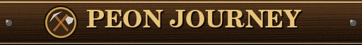

<p align="center"></p>

# Peon Journey

A free, standalone leveling guide addon for **World of Warcraft: Forever**. It covers levels 1 to 60,
every dungeon with its pre-quests, class quests worth doing, professions 1-300 and a gold routine,
all inside the game.

It runs on the **RestedXP guide engine** (the free, open edition, built in), so you get the same
guide window, waypoint arrow and auto-ticking steps. The guides from level 21 to 60, the dungeon,
class, profession and gold guides, the planner and the look are Peon Journey's own.

**[Download the latest PeonJourney.zip](https://github.com/MaNiasudo/peon-journey/releases/latest/download/PeonJourney.zip)**

## What is inside

| Group in the guide menu | What it does |
|---|---|
| **1-60 Speed (with Dungeons)** | The fastest way to 60 in our model: the best-XP quests, one visit per zone, and only the dungeons worth the trip. Ends at 60 |
| **1-60 Speed (no Dungeons)** | The fastest solo questing to 60: weak quests and zones are skipped, a short grind fills a gap when no quest is worth it |
| **1-60 Full Journey** | Everything: every zone, every dungeon and wing with its pre-quests, in level order and continent blocks, Mount Hyjal last |
| **Dungeon Quests Only** | All 28 dungeons (19 classic + 9 new Forever ones); Scarlet Monastery, Dire Maul, Blackrock Spire and Stratholme split into their wings. Pick any, at any level |
| **Class Quests** | Class quests worth doing: reward items with their Forever stats, must-do ability quests, level 60 chains |
| **Attunements** | Onyxia (with Forever's new Horde quest Blood and Thunder), Molten Core and Blackwing Lair (not open yet), and the dungeon keys: UBRS, Scholomance, BRD, Dire Maul, Dalaran Sewer Key, Scepter of Celebras, Krol'dok, Mallet of Zul'Farrak, plus which keys drop where |
| **Professions** | 1-300 for all 12 professions, with Forever's recipe changes, trainer waypoints and gathering loop routes |
| **Gold** | The weekly "In Demand" quest, writs and crates, farm spots at 60 |

Estimated play time from level 21 in our model (not measured in game): Speed (with Dungeons) about 83 hours,
Speed (no Dungeons) about 95-105 hours, Full Journey about 200-220 hours. `data/route_report.txt` has the leg-by-leg numbers.

- Dungeon guides come in two parts: the **pre-quests** (solo, with how many and roughly how long) and the **run**
  (pick-ups, then the guide asks you to find a group at the entrance, one run, hand-ins).
- New Forever zones are part of the route: Wetlands (new quests), Desolace, **Riverglades**, **Shen'dralas**, Azshara (new quests) and **Mount Hyjal**.
- New Forever dungeons: Hall of Thanes, Ruins of Lordaeron, Excavation Site: Wetlands, City of Dalaran (key chain included), The Drowned City, Krol'dok Stronghold, Alcaz Prison, Blackmaw Hold, Shaper's Terrace.
- It detects your race and class. A Tauren starts in Mulgore, an Orc in Durotar, a Skyborne on Zephras Isle, and you only see your own class quests.
- `/pj` opens the planner: what fits your level right now, per tab (Speed, Speed Quests, Full Journey, Dungeons, Class, Attunements, Professions, Gold), with a "Load guide" button on every row.

## Install

1. Download **[PeonJourney.zip](https://github.com/MaNiasudo/peon-journey/releases/latest/download/PeonJourney.zip)**.
2. Unzip it into your WoW Forever `Interface/AddOns/` folder. You should end up with `AddOns/PeonJourney/PeonJourney.toc`.
3. In the AddOns list on the character screen, enable **Peon Journey** and **disable RestedXP Guides** if you have it.
   Peon Journey already contains the engine, and two copies conflict. If both are on, the addon offers to turn RestedXP off for you.

## How to use

- **Pick a guide:** right-click the title bar of the guide window, choose a Peon Journey group, then a level bracket, then a guide.
  Or type `/pj` (or click the pick-and-axe minimap button) and press **Load guide** on a row.
- **It runs by itself:** steps tick off as you accept, kill, loot and turn in. When a guide ends, the next one loads.
- **Move:** drag the title bar. **Resize:** hold Alt and drag. **Scale and other settings:** `/rxp`.
- **Minimap button:** left-click for the planner, right-click to show or hide the guide window. `/pj help` lists the commands.
- **Stuck step?** Right-click it and skip it, then please report it (see below).

## How it is made

- **Engine and levels 1-21:** RestedXP Guides free edition `v4.11.37`, renamed and themed. Its hand-made starting routes are kept for every race.
- **Levels 21-60, dungeons, class quests, attunements:** generated from the WoW Forever data in [QuestieDB](https://github.com/Questie/QuestieDB)
  (real quest IDs, NPC spots, prerequisites and Forever quest XP). Every quest is scored by XP per minute (quest XP against an
  estimated time to do it); the Speed routes keep the mix with the fewest estimated hours that still reaches 60 in an XP
  simulation for both factions. Zone order follows the public Forever leveling guides (continent blocks, Mount Hyjal last).
- **RestedXP's free dungeon guides (1-21):** patched to say how many solo pre-quests come first and to ask for a group at the entrance, not at the start.
- **Professions, gold, class rewards:** collected from public Forever guides and item pages (Wowhead Forever, ConquestCapped,
  wow-professions, wow.gg and others, listed in `data/research/`).
- **Checks before every release:** guide grammar against the engine's parser, every guide-to-guide link, no step that can never finish,
  no hand-in before its pick-up, quest log never above 18, and the planner code run against a mocked WoW API.

This is generated from data, not walked by hand. Expect some detours. Reports make it better.

## Report a problem

Open an [issue](https://github.com/MaNiasudo/peon-journey/issues) with the **guide name**, the **step number**,
your **race and class**, and any red Lua error text.

## Build it yourself

```bash
tools/build_all.sh   # downloads QuestieDB Forever data + the free RestedXP release, regenerates PeonJourney/, runs the checks
```

Needs Python 3.10+. The scripts in `tools/` read data only and never run downloaded code.

## Licenses and credits

Peon Journey is free and **non-commercial**. It bundles parts with different licenses:

| Part | License |
|---|---|
| Guide engine, base textures and the 1-21 starting guides from [RestedXP Guides](https://github.com/RestedXP/RXPGuides) (free edition) | [CC BY-NC-SA 4.0](LICENSES/CC-BY-NC-SA-4.0.txt) |
| Peon Journey's own code (`Core.lua`, `Planner.lua`), generated guides, art in `art/` and `tools/` | [GPL-3.0](LICENSES/GPL-3.0.txt) |

- Quest, NPC and node data come from [QuestieDB](https://github.com/Questie/QuestieDB). No QuestieDB files are included here; the
  guides only use facts from it (IDs, positions, names). The Questie team allows reuse under GPLv3 terms, which is why Peon Journey's own parts are GPL-3.0.
- Not affiliated with RestedXP, Questie or Blizzard Entertainment. World of Warcraft is a trademark of Blizzard Entertainment.
- Quest names and objective text are Blizzard game content, shown so the guide can tell you what to do.
